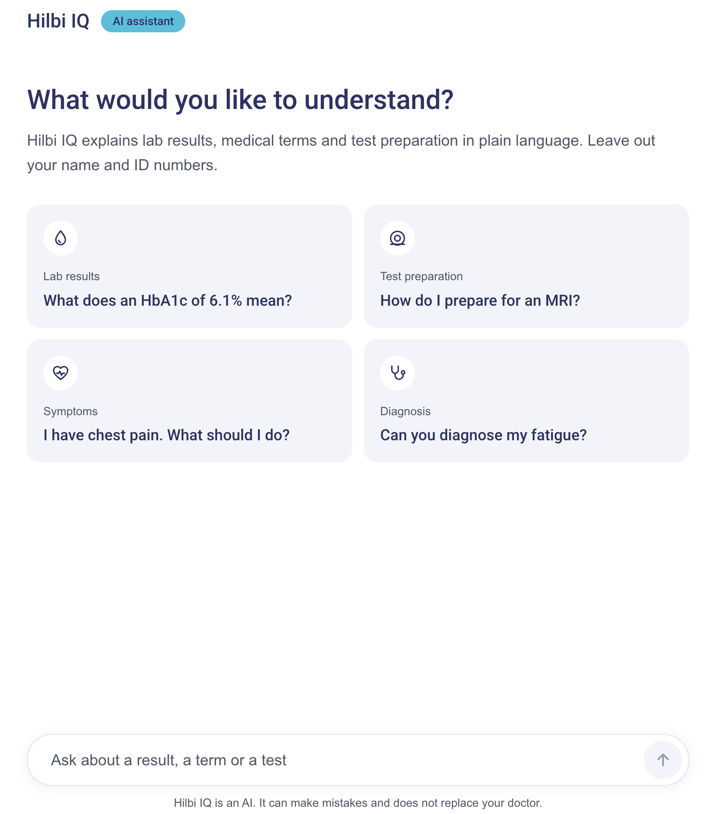
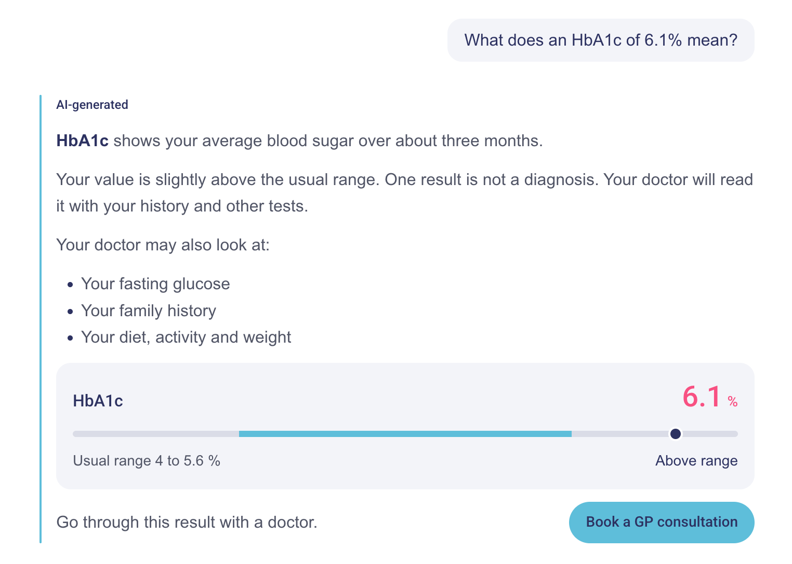
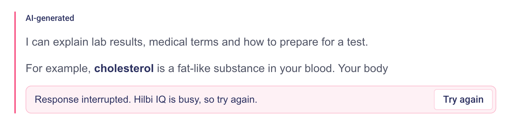
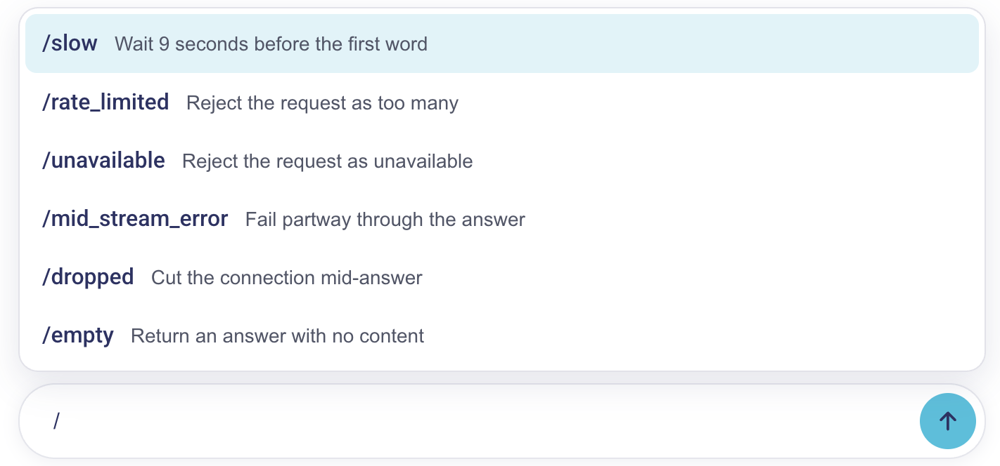

# Hilbi IQ chat

A streaming AI chat: an assistant that explains health information, built with Next.js and the Vercel AI SDK.

## Screenshots

### The chat

Answers stream word by word and are marked as AI-generated. Suggested questions help start a conversation, and follow-ups appear after each answer.



### Generative UI

Besides text, an answer can carry cards such as a lab result against its range, a preparation checklist, a safety notice or a next step with a doctor.



### Error handling

Each failure gets a clear message: a rate limit, a busy model, a lost connection. A broken answer keeps what arrived, and "Try again" continues it from where it stopped.



### Slash commands

Typing `/` opens a menu of demo scenarios, so every state of the chat can be shown without a real failure.



## Run

```bash
pnpm install
pnpm dev
```

- http://localhost:3000 — the chat.
- http://localhost:3000/?demo=1 — the chat with a panel that forces a scenario.

## What you can try

- **Suggestions** on the empty screen each lead to a different answer: a lab result, a preparation checklist, a safety notice and a refusal.
- **Slash commands.** Type `/` in the input to play a scenario: `/slow`, `/dropped`, `/mid_stream_error`, `/rate_limited`, `/unavailable`, `/empty`.
- **Recovery.** After a broken answer, "Try again" continues it from where it stopped.
- **Personal data.** Type an email, phone or birth number: the input warns, and the message is masked before sending.
- **Stop** an answer while it streams, and **follow-up questions** after a finished one.

## Key decisions

### A mock `/iq` of our own, and that is why it is Next.js

The brief mentions a mock `/iq` endpoint, but none came with it, so the project includes a small one. That is the only reason this is a Next.js app: a route handler serves `/iq` next to the UI. Without it, the chat would be a plain React app talking to Hilbi's endpoint. Once that endpoint exists, `src/server` and `app/iq` can be deleted, and only `ApiRoutes.Iq` needs to point at it.

### The Vercel AI SDK as the base

The AI SDK is the industry standard for AI chat in React, so the project builds on it rather than on a hand-written stream. `useChat` owns the transport, the streaming protocol and the message state. The mock gateway runs the real SDK pipeline (`streamText`, `smoothStream`, `toUIMessageStreamResponse`) over a mock model, so swapping in a real provider is a one-line change.

The code in this repo is what the SDK does not cover: a status for each answer, specific error messages, continuing a broken answer, masking personal data, and generative UI cards rendered from tool calls.

### Feature-based structure

The code is split by what it does for the product, not by file type. There are three layers: pages use features, and features use shared code.

- **Pages** compose features into screens and hold no logic of their own. In a plain React project they live in `pages/`; here the Next.js `app/` directory plays that role: `app/page.tsx` shows the chat or the demo panel, and `app/layout.tsx` wraps every page in the layout.
- **Features** (`features/`) carry the product logic, one folder per feature: `Chat` with its state, messages, input and generative UI, `Layout` with the frame and header every page shares, and `DemoPanel` with the mock scenario controls. Other code reaches a feature only through its `index.ts`, the way `DemoPanel` wraps `Chat`.
- **Shared** (`shared/`) is for two kinds of things:
  - **What several parts reuse:** API contracts, common logic, UI primitives, icons, styles and anything else reusable.
  - **What should be easy to find and change**, even if only one place uses it: links, routes, configuration and other constants.

`server/` stands apart: it is the mock gateway behind `/iq`, and nothing on the client imports it.

Inside a feature, code lives where it is used. A component folder holds its own `components/`, `hooks/`, `lib/` and `constants/`, and each piece sits at the level of the component that uses it: what only `LabResult` needs is in `LabResult/lib/`, and what several components share sits with their nearest common parent. A component can be read, moved or deleted together with everything it uses, and `shared/` does not turn into a dump of single-use helpers. Child components are imported through `components/index.ts`, so each parent has one import for its children.

ESLint guards the boundaries: features and shared code cannot import `server/`, another feature's internals or zod, which stays with the gateway.

## Commands

| Command          | What it does                       |
| ---------------- | ---------------------------------- |
| `pnpm dev`       | Dev server                         |
| `pnpm build`     | Production build                   |
| `pnpm start`     | Serve the production build         |
| `pnpm test`      | Unit and component tests           |
| `pnpm typecheck` | TypeScript check                   |
| `pnpm lint`      | ESLint                             |
| `pnpm format`    | Prettier                           |
| `pnpm icons`     | Generate icon components from SVGs |

## Structure

```
src/
  app/          Routes. app/iq/route.ts serves POST /iq.
  features/
    Chat/       The chat: useChat from the AI SDK, messages, input, generative UI.
    Layout/     The frame every page shares: header and main area.
    DemoPanel/  The chat with mock scenario controls.
  shared/
    api/        The /iq contract and the chat transport.
    constants/  API routes, links, demo scenarios.
    lib/        Shared logic, such as privacy masking.
    ui/         UI primitives and generated icons.
    assets/     Styles, design tokens and icon SVGs.
  server/       Mock /iq gateway: streamText over a mock model.
  __tests__/    Tests.
```

Icons are SVG files in `shared/assets/icons`; run `pnpm icons` after adding one.
